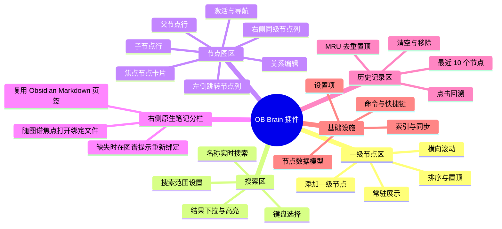
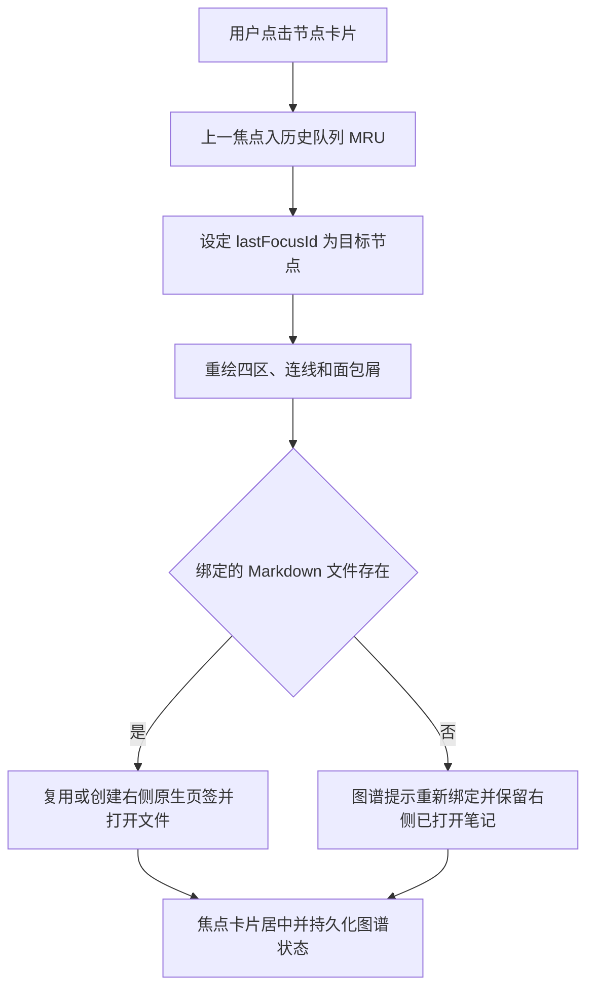
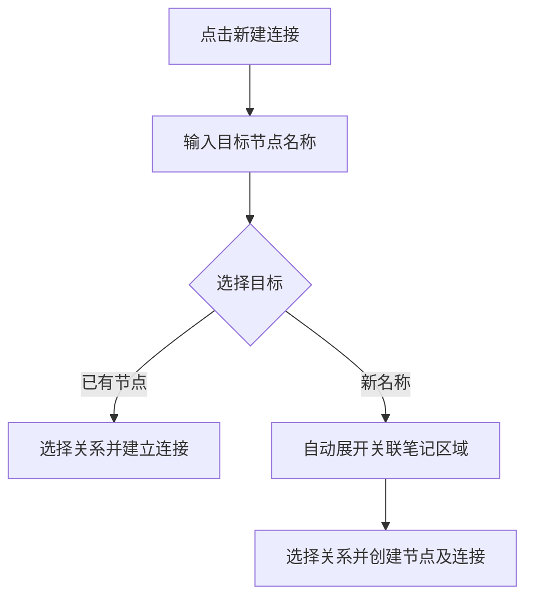

# OB Brain · Obsidian 脑图插件功能需求说明

| 项目 | 内容 |
| --- | --- |
| 插件名称（暂定） | OB Brain（TheBrain 风格的知识网络视图） |
| 文档版本 | v1.0（需求评审稿） |
| 日期 | 2026-11-18 |
| 目标平台 | Obsidian 桌面端（Windows / macOS / Linux），移动端为 P2 |
| 文档定位 | 面向开发的功能需求说明（FRD），可直接拆解为开发任务 |

---

## 1. 背景与目标

### 1.1 背景
Obsidian 的知识组织以「文件 + 双链 + 图谱」为核心，但图谱视图是全局的、无层级的、不可编辑的；日常使用中缺少一个**可操作的、以当前节点为中心的局部知识网络视图**。TheBrain 的核心体验是以当前想法（Thought）为焦点，按关系分区展示节点：上方为父节点，下方为子节点，左侧为跳转节点，右侧为同级节点。点击任意节点即可切换焦点。

本插件把这个体验移植到 Obsidian，并与其笔记体系绑定——**每个节点对应一篇真实笔记**，导航即笔记导航。

### 1.2 产品目标
1. 提供「以当前节点为中心」的局部关系导航视图，替代反复点击双链、来回切标签页的低效操作。
2. 一级节点（顶层标签）常驻顶部，形成稳定的知识域入口；最近访问的节点常驻底部，形成快速回溯通道。
3. 节点与笔记 1:1 绑定，导航到节点即定位到笔记，不留"孤立的图"。
4. 关系可编辑：新增节点、挂接父子、建立跳转链接，全部在图视图内完成，无需手动改 Markdown。

### 1.3 非目标（本期不做）
- 不做全局知识图谱的替代品（全局关系网络仍由 Obsidian 原生 Graph View 承担）。
- 不做卡片式自由画布 / Excalidraw 式的自由拖拽布局（列为 P2 探索）。
- 不做 AI 自动生成知识结构、不做跨库合并。
- 不做笔记正文的全文搜索引擎（搜索仅针对节点名称，P1 可扩展到别名与正文摘要）。

---

## 2. 术语定义

> 关系分区参照 [TheBrain 官方用户指南，第 6–7 页](https://assets.thebrain.com/documents/TheBrain12/TheBrain12-User-Guide_V14.pdf#page=15)。

| 术语 | 定义 |
| --- | --- |
| **节点（Node）** | 知识网络的最小单位，绑定一篇 Markdown 笔记，拥有唯一 ID、标题、颜色、图标。对应 TheBrain 的 Thought。 |
| **一级节点（Root Node）** | 位于层级顶部的入口节点，常驻视图顶部标签区；一个 Vault 可设置多个一级节点。 |
| **父/子链接** | 有向边 父 → 子，父节点显示在焦点上方、子节点显示在焦点下方。一个节点可有多个父、多个子。 |
| **跳转节点（Jump Thought）** | 与焦点通过跳转链接直接相连的节点，显示在左侧。跳转链接（Jump Link）表示用户手动建立的非层级、可双向浏览的关联。 |
| **同级节点（Sibling Thought）** | 与焦点共享至少一个直接父节点的其他节点，显示在右侧。根据这些父节点的其他直接子节点自动推导。 |
| **激活（Activate）** | 将某节点设为当前焦点节点，视图重绘它的父、子、跳转与同级节点，同时写入历史记录。 |
| **原生笔记分栏** | Obsidian 主工作区中位于图谱右侧的 Markdown 页签。插件将焦点笔记交给该页签，阅读、编辑和保存由 Obsidian 提供。 |
| **历史记录（History）** | 最近被激活的节点序列（MRU 队列，容量 10）。 |
| **索引（Index）** | 插件启动时扫描 Vault，构建的「节点元数据 + 关系」内存图。 |

---

## 3. 用户与典型场景

### 3.1 目标用户
- 已有成体系笔记、希望按主题层级组织内容的 Obsidian 用户（研究者、产品/技术人员、长期写作者）。
- 从 TheBrain 迁移过来，习惯焦点四周按关系分区的导航方式的用户。

### 3.2 典型场景

**场景 A｜按主题进入**
打开 OB Brain 视图 → 顶部点「机器学习」→ 焦点变为机器学习，下方出现「Transformer / 强化学习 / 数据预处理」→ 点 Transformer → 进入其笔记，同时其子节点展开。全程不打开文件树。

**场景 B｜跳转与同级浏览**
以「Transformer」为焦点，左侧显示手动关联的「BERT」，右侧显示同属「机器学习」的「强化学习」和「数据预处理」。点击左侧可跨主题跳转，点击右侧可沿共同父节点浏览其他主题。

**场景 C｜回溯**
连续跳转 7 次后迷路 → 底部历史记录显示最近 10 个节点 → 点第 4 项直接回到起点。

**场景 D｜整理**
整理「读书笔记」时新建子节点「2026 年书单」，绑定新笔记；把已有笔记「深度工作」拖到「时间管理」下挂接；把「深度工作」设为一级节点。

**场景 E｜搜索**
只记得名字里带"图"，顶部搜索框输入"图"，下拉列出「知识图谱 / 图谱视图 / 图表设计」，键盘 ↓ 选中后 Enter 激活。

---

## 4. 功能结构总览



---

## 5. 界面布局

### 5.1 整体结构（主工作区左右分栏）

```
┌──────────────────────────────────────────┬──────────────────────────┐
│ 搜索节点名称…           ＋ 新建一级节点   │ 机器学习.md               │
│ 一级节点  [机器学习] [读书笔记] [产品思考]   │ Obsidian 原生页签         │
├──────────────────────────────────────────┤                          │
│                父节点                     │                          │
│          ( 人工智能 ) ( 数据科学 )        │ 由 Obsidian 显示笔记正文、  │
│                  │                       │ 原生阅读视图与编辑视图     │
│ 左侧跳转节点      │          右侧同级节点  │                          │
│ [数据伦理] ··· [机器学习] ╌╌ [计算机视觉]  │                          │
│                  │                       │                          │
│                子节点                     │                          │
│   [Transformer] [强化学习] [数据预处理]   │                          │
├──────────────────────────────────────────┤                          │
│ 最近访问 [人工智能] [Transformer] … 清空  │                          │
└──────────────────────────────────────────┴──────────────────────────┘
```

### 5.2 布局规则
| 编号 | 规则 |
| --- | --- |
| L-01 | 搜索区与一级节点区合并为**顶部固定区**，高度自适应（≤ 96px），不随内容滚动。 |
| L-02 | 历史记录区固定在图谱视图底部，单行横向滚动，高度 40–56px。 |
| L-03 | 节点图区为中部可滚动区域（纵向滚动为主），占据剩余全部高度。 |
| L-04 | 图谱位于主工作区左侧，右侧为 Obsidian 原生笔记分栏，默认约占工作区 40%。分栏宽度可通过 Obsidian 原生分割线拖动。 |
| L-05 | 图谱视图较窄（< 480px）时，一级节点区改为「当前一级 + 更多▾」；原生笔记分栏遵循 Obsidian 工作区布局。 |
| L-06 | 所有区域使用 Obsidian CSS 变量（`--background-primary`、`--text-normal` 等）适配浅色/深色主题，不硬编码颜色。 |

---

## 6. 功能需求详述

> 优先级：**P0** = MVP 必须；**P1** = 第二迭代；**P2** = 后续增强。

### 6.1 一级节点区（顶部标签区）

| 编号 | 需求 | 优先级 |
| --- | --- | --- |
| FR-1.1 | 展示所有被标记为一级节点的节点，横向排列、可横向滚动；超出宽度时显示左右箭头。 | P0 |
| FR-1.2 | 每个一级节点以标签展示名称和左侧色条。 | P0 |
| FR-1.3 | 当前焦点节点若本身是一级节点，对应 chip 高亮；若焦点是某个一级节点的后代，该一级节点 chip 显示为"活跃态"（淡高亮 + 路径提示）。 | P0 |
| FR-1.4 | 单击 chip = 激活该节点（执行 FR-3.2 的激活流程）。 | P0 |
| FR-1.5 | 点击一级节点栏的「＋」创建独立一级节点。已有节点可通过右键菜单固定到一级节点栏。 | P0 |
| FR-1.6 | 一级节点支持拖拽改变顺序（写入每个节点的 `order` 字段），顺序在重启后保持。 | P1 |
| FR-1.7 | 排序模式设置项：「手动顺序（默认）／按名称／按最近激活」。切换后拖拽排序自动禁用并提示。 | P1 |
| FR-1.8 | 右键 chip 快捷菜单：打开笔记、设为当前、重命名、取消一级节点、删除节点。 | P1 |
| FR-1.9 | 一级节点数量 > 30 时，超出部分收纳进「更多▾」下拉，保持顶部区高度稳定。 | P1 |
| FR-1.10 | 空态：无任何一级节点时，顶部区显示「还没有一级节点」，并提供「＋」创建入口。空图谱提供「创建第一个节点」。 | P0 |
| FR-1.11 | 「扫描库内标签自动生成」：读取 Vault 全部 `#tag`，按使用频次列出，勾选后批量生成一级节点与绑定笔记。 | P1 |

### 6.2 搜索区（按标签/节点名称搜索）

| 编号 | 需求 | 优先级 |
| --- | --- | --- |
| FR-2.1 | 顶部固定搜索输入框，占位提示「搜索节点名称…」，支持点击或 `Ctrl/Cmd+K` 聚焦。 | P0 |
| FR-2.2 | 输入后**实时**过滤（输入防抖 200ms），按节点**名称**匹配；匹配规则：包含匹配（不区分大小写），命中片段高亮。 | P0 |
| FR-2.3 | 下拉结果列表（最多 20 条），每项展示：图标、节点名称（高亮匹配）、所属路径面包屑（如 `机器学习 › Transformer`）、笔记是否存在标记。 | P0 |
| FR-2.4 | 键盘操作：`↑/↓` 移动选中项，`Enter` 激活节点并在右侧原生分栏打开笔记，`Esc` 关闭下拉。 | P0 |
| FR-2.5 | 结果排序：完全匹配 > 前缀匹配 > 包含匹配；同分时按最近激活时间倒序。 | P1 |
| FR-2.6 | 无匹配时，结果列表仅显示「未找到匹配节点。」 | P1 |
| FR-2.7 | 搜索范围设置项：「全库节点（默认）／仅当前焦点的子图（深度 ≤ 2）」。 | P1 |
| FR-2.8 | 扩展匹配（P1 可选）：节点别名 `aliases`、拼音/首字母（如输入 `jqxx` 命中「机器学习」）、笔记正文摘要（最多 200 字符）。 | P1 |
| FR-2.9 | `Enter` 后输入框清空并失焦，焦点回到节点图区（可通过 `Tab` 再次聚焦）。 | P0 |
| FR-2.10 | 搜索结果中标注「未绑定笔记」的节点，激活时图谱显示创建或重新绑定引导（FR-4.5）。 | P0 |

### 6.3 节点图区（焦点 / 父 / 子 / 跳转 / 同级）

#### 6.3.1 展示
| 编号 | 需求 | 优先级 |
| --- | --- | --- |
| FR-3.1 | 焦点居中，**上方显示父节点，下方显示子节点，左侧显示跳转节点，右侧显示同级节点**。空间不足时，跳转与同级可在下方以两个独立区块展示。 | P0 |
| FR-3.2 | 节点卡片（小卡）以黑色显示名称，保留节点颜色左边条。跳转节点可显示其子节点数量；节点名称显示不全时，悬停在光标右下方以白底黑字提示完整名称。 | P0 |
| FR-3.3 | 焦点卡片（大卡）以更大字号和黑色居中展示完整名称，节点标签同样居中。所有图谱卡片无阴影，使用底色标识焦点卡片。关系分区仅展示节点卡片和必要的展开入口。 | P0 |
| FR-3.4 | 连线：父→焦点、焦点→子使用曲线（SVG path），跳转链接使用虚线与双向箭头，从焦点卡片到每个右侧同级节点绘制一条无箭头的点线。所有连线和箭头均为灰色。连线表达由共同父节点推导的关系。共享多个父节点时只画一条线，卡片可显示共同父节点名称。 | P0 |
| FR-3.5 | 子节点按可用宽度自动换行，同级节点每列最多 8 个，按列排列且列表内无滚动条。子节点、跳转节点和同级节点各超过 32 个、父节点超过 12 个时，显示「+N 更多」按钮，点击展开全部。 | P0 |
| FR-3.6 | 面包屑：位于节点图区顶部，显示从最近的一级节点到焦点的路径（如 `机器学习 › Transformer › 位置编码`），每级可点击激活。 | P1 |
| FR-3.7 | 缩放（`Ctrl + 滚轮`，50%–200%）与平移（空白处拖动 / 触控板双指）：P2 自由画布阶段实现；P0 采用流式布局，无需缩放。 | P2 |
| FR-3.8 | 关系分区无节点时直接留白。 | P0 |

#### 6.3.2 导航与激活
| 编号 | 需求 | 优先级 |
| --- | --- | --- |
| FR-3.9 | **激活流程**：单击任意节点卡片 → 1) 设定为当前焦点；2) 立即重绘父、子、跳转与同级四个区域；3) 将上一焦点压入历史记录（当前焦点不写入）；4) 请求在右侧原生 Markdown 页签打开绑定笔记；5) 保留滚动位置（焦点卡片定位到可视区中央，`scrollIntoView({block:'center', behavior:'smooth'})`）。 | P0 |
| FR-3.10 | 激活需在 200ms 内完成视图重绘（2000 节点规模），通过原生页签异步打开笔记，图谱重绘可先完成。 | P0 |
| FR-3.11 | 双击节点卡片 = 激活节点并将操作焦点移至右侧原生笔记页签。 | P1 |
| FR-3.12 | 节点右键菜单提供「新建连接」和「固定到一级节点栏」等操作。 | P1 |
| FR-3.13 | 键盘导航：`Tab/Shift+Tab` 在父节点、跳转节点、焦点、同级节点和子节点之间顺序或逆序移动焦点框；`Enter` 激活；`Backspace` 返回历史上一节点（等同 FR-5.5）。 | P1 |
| FR-3.14 | 焦点节点被外部删除（文件不存在）时：卡片显示「笔记缺失」警示样式，属性面板仍可用，提供「重新绑定笔记」。 | P0 |

#### 6.3.3 关系编辑
| 编号 | 需求 | 优先级 |
| --- | --- | --- |
| FR-3.15 | 「新建连接」弹窗按名称搜索已有节点，点击候选后可建立父、子或跳转关系。只有一个候选时也需点击确认。两个节点已有任一直接关系时，显示红字并禁用「建立连接」。输入未使用的名称时，保留部分匹配的候选节点，并展开关联笔记区域，可按输入名称创建目标节点及关系。 | P0 |
| FR-3.16 | 拖拽子节点卡片到另一个节点卡片上 = 建立「目标 → 被拖节点」的父→子链接；拖到左侧跳转区 = 与焦点建立跳转链接。右侧同级区由父子关系自动更新，挂接到共同父节点即可形成同级关系。拖拽时可接收的目标高亮描边。 | P1 |
| FR-3.17 | 断开链接：子节点卡片右键 → 「断开与当前节点的链接」（删除边，不删除节点与笔记）。 | P1 |
| FR-3.18 | 支持一个节点拥有**多个父节点**（TheBrain 特性）：同一节点可同时出现在多个父节点的子列表中，并可在焦点页看到全部父节点。 | P0（数据层）／P1（UI 编辑） |
| FR-3.19 | 防环校验：允许环（TheBrain 允许），但激活时不做无限展开——只渲染一层父/子，天然无递归风险。 | P0 |
| FR-3.20 | 删除节点（右键 → 删除）：弹窗三选一 ——「仅解除关系（保留笔记）／移入 Obsidian 回收站（含笔记）／取消」，默认第一项。 | P0 |
| FR-3.21 | 所有关系写操作后，1s 内落盘到笔记 frontmatter（见 §7），失败时提示并回滚内存状态。 | P0 |
| FR-3.22 | 右侧同级节点由焦点的全部有效直接父节点推导：合并各父节点的直接子节点，排除焦点自身，按节点 `id` 去重。父子关系增删或索引同步后，重新计算受影响的同级列表。 | P0 |
| FR-3.23 | 左侧跳转区展示与焦点通过 `jumps` 相连的有效节点，支持从任一端切换到另一端，同一目标按节点 `id` 去重。 | P0 |

### 6.4 右侧原生笔记分栏

原生阅读与编辑行为参见 [Obsidian 官方帮助](https://obsidian.md/help/edit-and-read)。

| 编号 | 需求 | 优先级 |
| --- | --- | --- |
| FR-4.1 | 激活节点后，将它绑定的 Markdown 文件交给图谱右侧的 Obsidian 原生页签打开。首次需要时，基于图谱页签向右分栏，例如 `workspace.createLeafBySplit(graphLeaf, 'vertical', false)`，再调用 `WorkspaceLeaf.openFile`。 | P0 |
| FR-4.2 | 图谱复用右侧原生笔记页签，重启时等待工作区恢复后按页签标识重新绑定。旧版本升级时优先复用图谱右侧已打开的焦点笔记。仅在页签关闭或失效且没有可复用页签时创建分栏。 | P0 |
| FR-4.3 | 单击图谱、一级入口、搜索或历史中的节点后，切换右侧文件并将操作焦点保留在图谱导航中。快速连续切换时，串行处理文件打开请求并合并尚未开始的请求，最终显示最新焦点的笔记。 | P0 |
| FR-4.4 | 阅读视图、实时预览、源码模式、模式切换、正文编辑与保存均由 Obsidian 原生 Markdown 页签处理。插件只负责定位并打开文件。 | P0 |
| FR-4.5 | 未绑定或找不到文件时，图谱中的焦点卡片显示相应状态并提供「新建笔记并绑定」「关联已有笔记」。保留右侧已打开的笔记，提示本次未切换。 | P0 |
| FR-4.6 | 原生页签打开失败时，在图谱中显示「打开笔记失败」及重试入口，保留当前图谱焦点。 | P0 |
| FR-4.7 | 网页原型的右侧展示原生页签占位及目标文件名和路径，点击节点时同步更新。原型只演示打开笔记的交接状态。 | 原型 |
| FR-4.8 | 通过 Obsidian 原生分割线调整左右宽度，由工作区保存布局。 | P0 |
| FR-4.9 | 页签中的双链、嵌入、属性和文件内容变更遵循 Obsidian 原生行为。图谱激活负责驱动页签切换。 | P0 |

### 6.5 历史记录区（底部）

| 编号 | 需求 | 优先级 |
| --- | --- | --- |
| FR-5.1 | 保存**最近打开的 10 个节点**（MRU 队列），超出容量时淘汰最旧项。 | P0 |
| FR-5.2 | 去重规则：同一节点再次激活 → 从原位置移除并插入队首；当前焦点节点**不写入历史**，仅在被"离开"时入栈。 | P0 |
| FR-5.3 | 每项展示：序号（1–10）、节点图标、节点名称、相对时间（"3 分钟前"）。 | P0 |
| FR-5.4 | 点击历史项 = 激活该节点（不重复入栈，遵循 FR-5.2）。 | P0 |
| FR-5.5 | `Backspace`（视图内）/ 命令「返回上一节点」= 激活历史队首并出栈（真·后退语义，区别于普通点击）。 | P1 |
| FR-5.6 | 悬停项显示 `×`，点击从历史中移除该项（不影响节点本身）。 | P1 |
| FR-5.7 | 「清空」按钮：二次确认后清空队列。 | P1 |
| FR-5.8 | 历史持久化到 `data.json`，重启 Obsidian 后依然保留最近 10 项。 | P0 |
| FR-5.9 | 空态：显示「暂无历史记录，点击上方节点开始」。 | P0 |
| FR-5.10 | 历史只统计**本视图内的节点激活**，不与 Obsidian 原生"最近文件"混用。 | P0 |
| FR-5.11 | 历史数量设置项：5–20 可配，默认 10，变更后立即裁剪队列。 | P1 |

### 6.6 命令、快捷键与设置

| 编号 | 需求 | 优先级 |
| --- | --- | --- |
| FR-6.1 | 命令：`打开 OB Brain 视图`、`激活节点（Quick Switch）`、`从当前笔记创建节点`、`将当前焦点设为一级`、`返回上一节点`、`清空历史`、`重建索引`。 | P0 |
| FR-6.2 | 视图注册为 Obsidian 自定义 `ItemView`（`VIEW_TYPE_OB_BRAIN`），在主工作区打开图谱页签，配对的原生 Markdown 页签位于右侧。 | P0 |
| FR-6.3 | `从当前笔记创建节点`：在当前激活的笔记中执行该命令，自动生成节点元数据（标题取 H1 或文件名），并可指定父节点。 | P1 |
| FR-6.4 | 快捷键默认不占用系统/常用组合，仅在设置页给出建议值，由用户自行绑定。 | P0 |
| FR-6.5 | 设置页分组：`节点与笔记`（存储文件夹、1:1 绑定、重命名是否同步文件）、`历史`（容量）、`搜索`（范围、扩展匹配开关）、`数据`（重建索引、导出图谱 JSON、导入、清除插件数据）。 | P0 |

### 6.7 数据同步与索引

| 编号 | 需求 | 优先级 |
| --- | --- | --- |
| FR-7.1 | 启动时扫描 Vault 内所有含 `ob-brain` frontmatter 的笔记，构建内存图索引；1000 篇笔记内 ≤ 3s，不阻塞首屏（异步 + 进度提示）。 | P0 |
| FR-7.2 | 监听 `vault.on('create'/'delete'/'rename')` 与 `metadataCache.on('changed'/'resolved')`，增量更新索引（防抖 300ms 批量处理）。 | P0 |
| FR-7.3 | 笔记重命名/移动由 Obsidian 自动更新链接，插件按 `id` 追踪节点，不依赖路径。 | P0 |
| FR-7.4 | 引用完整性校验：`children` / `jumps` 指向的 `id` 若不存在 → 标记为「悬挂链接」，在设置页「数据健康检查」中列出并提供一键清理。 | P0 |
| FR-7.5 | 幂等性：同一节点被重复索引、重复写 frontmatter 时结果一致，不产生重复边。 | P0 |

---

## 7. 数据模型

### 7.1 节点与笔记的绑定关系
- **1 节点 = 1 篇笔记（1:1）**，笔记本身即节点载体，节点 URL 即 `obsidian://open?vault=...&file=...`。
- 节点标识使用稳定 **ID**（`n_` + 8 位随机/哈希），而非文件路径，避免重命名断链。
- 新建节点时按笔记文件名检查同名 Markdown 笔记，并在关联笔记区用红字列出路径。唯一可绑定笔记会自动选中，存在多篇可绑定笔记时由用户选择。
- 新节点默认在设置项指定的文件夹（默认 `OB Brain/`）创建同名 Markdown 文件；`绑定已有笔记` 则直接写入该笔记的 frontmatter。

### 7.2 笔记 frontmatter（唯一真相源）

```yaml
---
title: Transformer
ob-brain:
  id: n_a1b2c3d4
  level: node            # root（一级节点）| node
  color: "#4C8DFF"
  icon: "🧩"
  order: 12              # 同级/一级节点排序权重
  children:              # 父→子 有向边（仅出边）
    - n_e5f6a7b8         # 注意力机制
    - n_c9d0e1f2         # 位置编码
  jumps:                 # 手动建立的跳转链接
    - n_11223344         # BERT
  description: "自注意力架构，NLP 与多模态主干"
  created: 2026-11-18T10:00:00+08:00
aliases: [Transformer, 变形金刚网络]
tags: [AI, ML]
---
```

**关键设计取舍**
1. **持久化 `children` 与 `jumps`**。父节点由 `children` 的反向索引推导。同级节点由共同父节点推导，frontmatter 无需 `siblings` 字段。跳转链接由创建方写入一次，读取时合并 `jumps` 的出边和入边，供两端浏览。
2. **关系分散在各笔记 frontmatter 中**，而非集中一份 `graph.json`：便于 Obsidian Sync / Git 做文件级合并，单篇笔记冲突不影响全局；插件另存 `data.json` 仅保存 **UI 状态**（历史队列与上次焦点）。
3. **`ob-brain` 为命名空间隔离**，不与用户既有 frontmatter 冲突；无此块的笔记不会被索引。
4. **兼容性**：`ob-brain` 缺失但 `title` 存在 → 视为未纳管笔记，仅在「从已有笔记创建」时补写。

### 7.3 插件 `data.json`（非业务数据）

```json
{
  "history": [
    { "id": "n_11223344", "activatedAt": 1763431200000 },
    { "id": "n_c9d0e1f2", "activatedAt": 1763430900000 }
  ],
  "lastFocusId": "n_a1b2c3d4",
  "historyCapacity": 10,
  "settings": { "nodeFolder": "OB Brain", "searchScope": "vault" }
}
```

### 7.4 索引内存结构

```ts
interface BrainNode {
  id: string;
  title: string;
  path: string;            // 当前文件路径（可漂移）
  level: 'root' | 'node';
  color: string;
  icon: string;
  order: number;
  parents: string[];       // 由 children 反向推导
  children: string[];
  jumps: string[];         // 该笔记持久化的跳转出边
  description?: string;
  tags: string[];
  mtime: number;
}
interface BrainIndex {
  nodes: Map<string, BrainNode>;
  roots: string[];         // level=root 且 order 排序后
  incomingJumps: Map<string, string[]>; // 由 jumps 构建的反向索引
  dangling: Array<{ from: string; to: string; field: 'children' | 'jumps' }>;
}
```

---

## 8. 关键交互流程

### 8.1 激活节点



### 8.2 新建连接



### 8.3 文件变更同步

```mermaid
flowchart LR
    A[metadataCache changed] --> B[防抖 300ms 批处理]
    B --> C{frontmatter 含 ob-brain?}
    C -- 是 --> D[解析 id/边/level, 差量更新节点]
    C -- 否且曾纳管 --> E[移出索引, 提示"节点已脱离"]
    D --> F[若当前焦点受影响 → 局部重绘, 保留滚动]
    E --> F
```

---

## 9. 边界、异常与状态规则

| 场景 | 期望行为 |
| --- | --- |
| 节点重名（不同笔记同名） | 已有的同名节点仍由各自的 `id` 区分。 |
| 新建节点名称与既有节点重复 | 所有新建节点入口实时提示重名并阻止创建，比较名称时忽略首尾空格及大小写。 |
| 笔记被外部删除 | 节点保留在索引中并标记 `missing`；卡片显示"笔记缺失"；提供「重新绑定 / 删除节点」。 |
| frontmatter 被手工改坏（非法 YAML） | 该笔记索引标记为 `error`，不进入图，设置页列出问题文件，不覆盖用户内容。 |
| `children` 指向不存在的 id | 记为悬挂链接，UI 不渲染该边，设置页可一键清理。 |
| 焦点节点无父无子 | 父区显示「（顶层节点）」，子区显示新建引导，右侧显示「暂无同级节点」。已有跳转仍显示在左侧。 |
| 同级节点与焦点共享多个父节点 | 右侧只展示一张卡片，可列出全部共同父节点。移除一个共同父节点后，若仍有其他共同父节点，该卡片继续显示。 |
| 历史为空 | 显示占位文案；`Backspace` 无响应且不报错。 |
| 同一节点重复点击 | 不产生重复历史项；右侧页签已显示目标文件时跳过重复打开。 |
| 超大 Vault（> 5000 笔记） | 只索引含 `ob-brain` 的笔记，索引耗时 > 5s 时展示进度条并允许取消。 |
| 多端同步冲突 | 关系分散在各自笔记中，冲突范围限定单文件；插件不做自动合并，交由 Obsidian Sync / Git。 |
| 视图关闭后重开 | 恢复 `lastFocusId`、历史队列与滚动位置；分栏布局由 Obsidian 工作区恢复。 |

---

## 10. 非功能需求

| 类别 | 要求 |
| --- | --- |
| 性能 | 激活响应 ≤ 200ms（2000 节点）；搜索首次结果 ≤ 100ms；1000 笔记建索引 ≤ 3s；内存增量 ≤ 50MB（2000 节点）。 |
| 兼容性 | Obsidian ≥ 1.4（桌面端）；`minAppVersion` 在 `manifest.json` 声明；不依赖第三方运行时。 |
| 主题 | 全部配色取自 Obsidian CSS 变量，支持浅色/深色/自定义主题；高对比度模式下节点边框可见。 |
| 可访问性 | 节点卡片可键盘聚焦（`tabindex`），焦点框可见，按钮文字提供完整节点名称，关系类型由所在分区标识。 |
| 数据安全 | 写 frontmatter 前做 YAML 解析校验；删除笔记走 Obsidian `fileManager.trashFile()`，绝不 `fs.unlink`。 |
| 国际化 | 文案集中管理，首版中英双语（`zh-cn` / `en`）。 |
| 可维护性 | 视图 / 索引 / 数据访问 / 组件四层分离；核心逻辑（索引、激活、MRU）纯函数化，便于单元测试。 |
| 测试 | 单元测试覆盖：索引构建、同级推导与去重、跳转双向读取、MRU 去重、悬挂链接校验、frontmatter 读写往返；手测清单覆盖 §9 全部边界。 |

---

## 11. 版本规划

| 版本 | 范围 | 内容 |
| --- | --- | --- |
| **v0.1 MVP** | P0 | 视图骨架（顶/中/底三段）、一级节点区展示与新增、名称搜索、焦点四区（父、子、左侧跳转、右侧同级）渲染、激活与右侧原生笔记页签联动、历史 10 条持久化、节点新建/删除、frontmatter 索引与增量同步、基础设置页、命令注册。 |
| **v0.2** | P1 主体 | 拖拽建链、跳转链接编辑、右键菜单、面包屑、键盘导航、多父节点 UI、搜索扩展（别名/拼音/摘要）、标签批量导入、数据健康检查、历史后退与清空。 |
| **v0.3** | P1 剩余 + P2 | 导出/导入图谱 JSON。 |
| **v1.0** | P2 探索 | 自由画布式缩放平移、移动端适配、多视图多工作区、节点分组/泳道、按标签自动聚类布局。 |

---

## 12. 验收标准（节选）

| # | Given | When | Then |
| --- | --- | --- | --- |
| AC-01 | 已配置 3 个一级节点 | 打开 OB Brain 视图 | 顶部按 `order` 展示 3 个 chip，点击任一 chip 完成激活 |
| AC-02 | 焦点为「机器学习」，它有 5 个子节点 | 点击子节点「Transformer」 | 1s 内焦点变为 Transformer，上方出现「机器学习」，下方出现其子节点，右侧 Obsidian 原生页签打开 Transformer |
| AC-03 | 连续激活 12 个不同节点 | 查看底部历史 | 仅保留最近 10 个，最旧 2 个被淘汰，顺序为 MRU |
| AC-04 | 重复点击历史中已存在的节点 | 激活它 | 该项移到队首，不产生重复条目 |
| AC-05 | 搜索框输入"图" | 停留 300ms | 下拉列出名称含"图"的节点（≤20 条），匹配片段高亮，`↓`+`Enter` 可激活 |
| AC-06 | 节点 A 的笔记被手动删除 | 在视图中查看 A | 卡片显示"笔记缺失"，提供重新绑定；不抛出控制台错误 |
| AC-07 | 新建节点时名称已存在 | 输入名称 | 输入框下方红字提示，并禁止创建 |
| AC-08 | 关闭视图后重启 Obsidian | 重新打开视图 | 焦点、历史 10 条、一级节点顺序恢复，原生工作区分栏布局恢复 |
| AC-09 | 2000 节点 Vault | 点击任一节点 | 视图重绘 ≤ 200ms（可用 Performance 面板验证） |
| AC-10 | 在某节点下新建子节点 | 查看该子节点笔记 frontmatter | 父节点 frontmatter 的 `children` 新增子节点 `id`；子节点含完整 `ob-brain` 块 |
| AC-11 | 「Transformer」与「BERT」通过 `jumps` 关联，两节点无共同父节点 | 分别激活两节点 | 对方均出现在左侧；右侧同级区不因这条跳转新增节点 |
| AC-12 | 节点 A 与 B 共享父节点 P、Q，C 与 A 仅共享父节点 Q | 激活 A，依次解除 Q → B、P → B | 右侧初始显示 B 和 C 各一次；移除 Q → B 后仍显示 B；移除 P → B 后仅显示 C；同级节点无须单独存储 |
| AC-13 | 「Transformer」和「强化学习」同属「机器学习」 | 点击右侧的「强化学习」 | 「强化学习」移到中央，上方仍显示「机器学习」，右侧出现「Transformer」且与新焦点通过无箭头点线相连，原生页签打开「强化学习」笔记 |
| AC-14 | 图谱旁已有原生笔记页签，且另一页签打开了无关文件 | 快速连续点击多个节点，再在右侧编辑末次选中的笔记 | 右侧复用同一配对页签并最终打开末次选中的文件；编辑与保存由 Obsidian 完成，其他页签保留 |

---

## 13. 待确认事项（含建议默认值）

| # | 问题 | 建议默认 | 影响 |
| --- | --- | --- | --- |
| Q1 | 节点与笔记是**同体**（1 节点=1 笔记），还是允许"纯节点无笔记"？ | 同体，1:1 强绑定；纯节点仅顶层域标签可例外 | 决定数据模型 |
| Q2 | 是否复用 Obsidian 原生 `#标签` 体系？ | 不强制复用，仅提供"从标签批量导入一级节点" | 决定一级节点来源 |
| Q4 | 多父节点（一个节点挂多个父）是否纳入 MVP？ | 数据层 MVP 支持，UI 编辑放 v0.2 | 决定建链交互复杂度 |
| Q5 | 中部图区采用**固定四区布局**还是自由画布？ | MVP 固定四区；画布放 v1.0 | 决定渲染架构（DOM vs Canvas/SVG） |
| Q6 | 是否支持移动端？ | 仅桌面端，移动端 P2 | 决定 UI 降级与触控交互 |
| Q7 | 是否需要多视图/多工作区（同时看两个焦点）？ | 单视图，多实例用 Obsidian 多标签页实现 | 决定状态管理粒度 |
| Q8 | 是否要导入 TheBrain 数据或 Obsidian Canvas？ | 不做，仅导出/导入自有 JSON | 决定迁移能力边界 |
| Q9 | 一级节点是否强制"域根"，即所有节点必须能追溯到某个一级节点？ | 不强制，允许游离节点（可通过数据健康检查提示） | 决定校验规则 |
| Q10 | 历史是否包含"从外部点击笔记"引起的切换？ | 不包含，只统计视图内激活 | 决定历史语义一致性 |

---

## 附录 A：与同类产品的差异点

| 维度 | TheBrain | Obsidian 原生 Graph | OB Brain |
| --- | --- | --- | --- |
| 局部性 | 焦点式，上父下子、左跳转右同级 | 全局网络 | 焦点式，上父下子、左跳转右同级 |
| 编辑关系 | 内置 | 只读（需手写双链） | 图内拖拽建链，写回 frontmatter |
| 数据归属 | 私有数据库 | 笔记文件 | 笔记 frontmatter（可移植、可版本控制） |
| 入口组织 | 无固定顶部入口 | 无 | 一级节点常驻顶部 |
| 回溯 | 有历史 | 无 | 底部 10 条 MRU |

## 附录 B：本文件对应开发任务拆解建议

1. `manifest.json` + `ItemView` 骨架 + 顶／中／底整体布局与 CSS 变量主题适配
2. 数据层：frontmatter 读写、索引构建、反向父节点推导、同级节点推导、跳转反向索引、增量同步、悬挂链接
3. 顶部区：一级节点 chips、新建表单、排序
4. 搜索：防抖过滤、下拉组件、键盘操作
5. 图区：父、子、左侧跳转和右侧同级渲染 + 连线 SVG + 激活流程
6. 原生笔记分栏：页签创建与复用、快速切换、失败重试与图谱内重新绑定提示
7. 历史：MRU 队列、持久化、后退语义
8. 关系编辑：新建子节点、删除、P1 拖拽建链
9. 设置页 + 数据健康检查 + 导入导出
10. 测试：单测（索引/队列/frontmatter）+ 手测清单（§9、§12）
